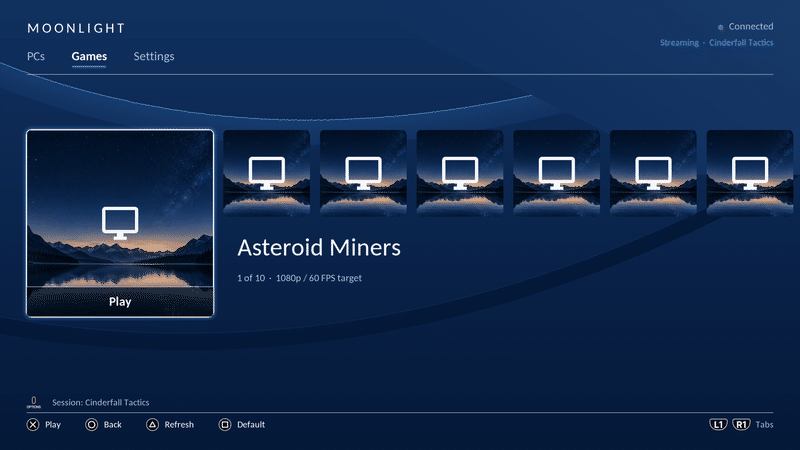
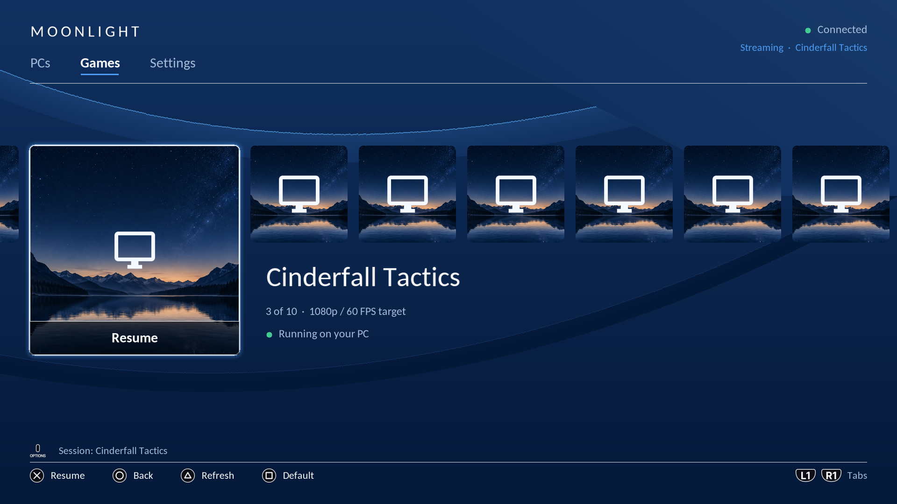
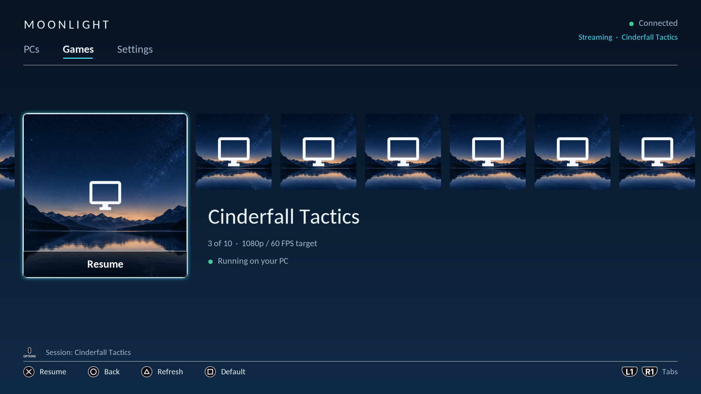
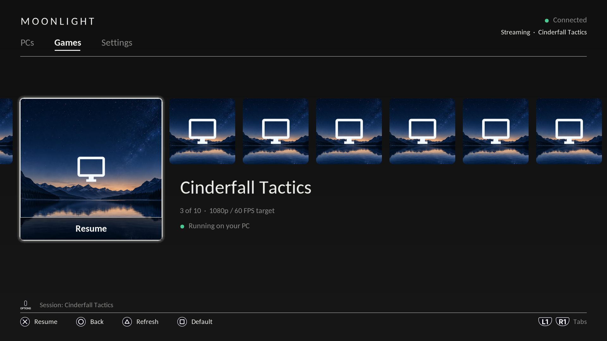
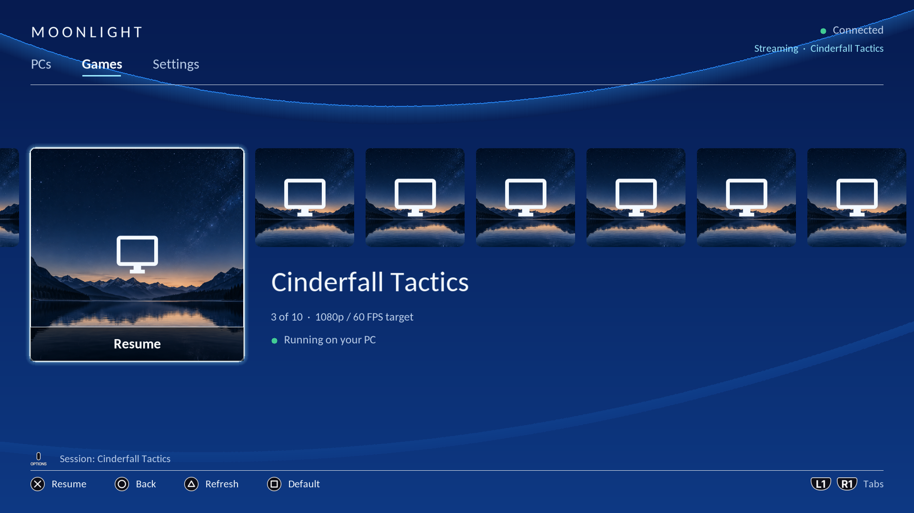
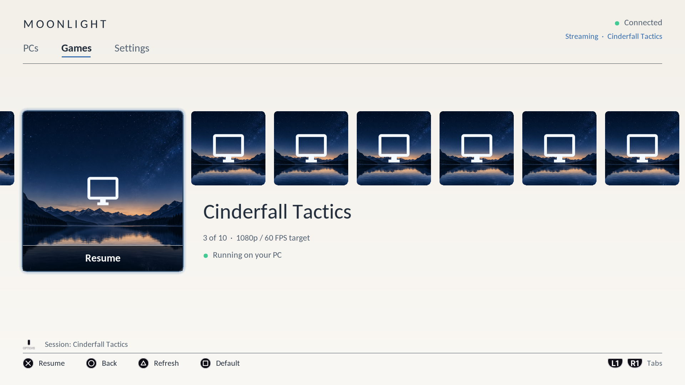
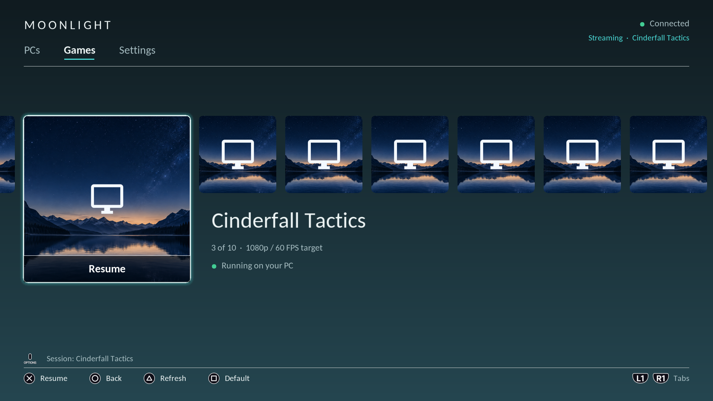

# Moonlight

### Release 1.6.0 · Experimental

Stream your PC games to a jailbroken PS4 with Sunshine and a DualShock 4.

Rendered by the actual C menu renderer on a development PC · Games, Settings and PCs tabs · Orbis (default) theme.

**[What's new](#whats-new-in-160)** · **[Install](#installation)** · **[Controls](#controls)** · **[Known issues](#known-issues)**

**[Download PKG](../../releases/download/v1.6.0/Moonlight-PS4-01.60.pkg)** · **[Release notes & checksums](../../releases/tag/v1.6.0)**

> **Unofficial client:** Moonlight PS4 is independently developed. It is not
> affiliated with, endorsed by, or maintained by the official Moonlight project.
> Product names belong to their respective owners.

## What's new in 1.6.0

Everything below is new since 1.5.5. The short version: the interface was
rebuilt in the PS4's own design language, the app remembers every computer
you play on, the Games row scrolls as smoothly as the dashboard, and
connecting got faster and more patient.

- **A PS4-style interface from top to bottom.** A header with tabs, a Games
  row where the highlighted game grows into a large hero tile, system-style
  notifications, an on-screen keyboard and native launch, pairing and error
  screens. Six themes
  restyle all of it, exactly the way PS4 themes work.
- **Smooth scrolling.** The Games row glides at your display's frame rate
  and settles quickly, so browsing your library feels like the dashboard.
- **The app remembers your PCs.** The PCs tab keeps up to 8 computers with
  live Online/Offline status, one-press Wake-on-LAN and an in-place
  **Add PC** row. Existing settings carry over automatically.
- **Faster, more patient connecting.** The PIN screen appears the moment
  the PC answers, pairing keeps retrying while you enter the PIN, and when
  something is wrong the app says in plain words what to fix.
- **5.1 / 7.1 surround sound** through the PS4's HDMI output, with an
  automatic fallback if your TV or receiver can't play it.
- **Clearer in-stream feedback.** The performance overlay judges dropped
  frames against your session's actual frame rate, and the quick menu's
  bitrate control now takes small steps (bigger jumps on L1/R1).
- **Smaller fixes:** the controller battery no longer claims a fake 100%,
  and there is no version popup at startup anymore.

## What's new in 1.5.5

Everything below is new since 01.35.

- **In-stream quick menu (hold L3 + R3)** — toggle the touchpad mouse and
  the performance overlay, change the bitrate, or quit the stream while
  the game keeps running on the PC. Input pauses safely while the menu is
  open.
- **Local co-op for up to 4 controllers** — every logged-in DualShock 4
  becomes its own gamepad on the PC, with rumble, Steam lightbar colors
  and motion (gyro) input. The touchpad works as a mouse.
- **Auto-reconnect** — a network blip or a Sunshine restart no longer
  dumps you into the menu: the client shows a reconnecting screen, tries
  to resume the running game three times, then waits with X-to-retry.
- **Animated launch screen with cancel**, connection errors in plain
  words, and an instant, honest PCs tab (your saved PC is listed
  immediately, its status dot fills in moments later).
- **Wake-on-LAN configures itself** after the first connect; SQUARE on
  the PCs tab sends the wake burst.
- **Instant games list** — the list and cover art load from cache
  immediately while the network refresh runs in the background, no
  network hiccup can freeze the menu, and leaving the app no longer
  shows a crash dialog (Settings → Exit Moonlight).
- **A new default theme (Orbis) plus five more**, sharper text and art
  everywhere, a scrollable Settings page with a helpful hint on every
  row, 5.1 surround sound, and SQUARE on a game to make it the boot
  default.

## Included features

- Local IPv4 discovery (subnet sweep + saved-host probe), manual IP entry
  and PIN pairing.
- A saved list of up to 8 PCs (most recently used first) with live
  Online/Offline status and per-PC Wake-on-LAN.
- Sunshine application list, launch/resume and Desktop streaming.
- H.264 hardware decoding, stereo or 5.1/7.1 surround Opus audio (with an
  automatic downmix ladder) and DualShock 4 input for up to four pads.
- Touchpad mouse, motion input, rumble and Steam lightbar mirroring.
- Wake-on-LAN with auto-detected MAC.
- In-stream quick menu (hold L3 + R3): toggles, bitrate, quit actions.
- Six saved themes: **Orbis (default) · Midnight · Mono · Blue Wave ·
  Daylight · Cinema**.
- Matching startup splashes, portrait covers and game panoramas.
- Balanced / Low latency modes, performance overlay and file logging.
- Auto-reconnect on drops; default app with boot auto-launch.
- Return to the client menu and a controller shortcut for the host Guide
  button.

<strong>The six themes</strong>

| Orbis (default) | Midnight |
| :---: | :---: |
|  |  |

| Mono | Blue Wave |
| :---: | :---: |
|  |  |

| Daylight | Cinema |
| :---: | :---: |
|  |  |

Images are previews produced by the actual C UI renderer on a development
PC, not PS4 captures. Game artwork in previews is generated placeholder art.

## Installation

**Tested setup:** original PS4, firmware **12.50**, GoldHEN, DualShock 4 and an
Ethernet-connected PC running [Sunshine](https://github.com/LizardByte/Sunshine).
The Windows test host uses ViGEmBus for controller emulation.

- **Package:** `Moonlight-PS4-01.60.pkg`
- **Title ID:** `MLNT00001`
- **Settings:** `/data/moonlight`

Download the PKG and `SHA256SUMS` from the
[1.6.0 release](../../releases/tag/v1.6.0).
Build from source using [docs/BUILD.md](docs/BUILD.md).

1. Install the PKG with GoldHEN's Package Installer. It updates an existing
   client using the same title ID and retains its saved settings.
2. Open **PCs** and press **Triangle** to discover your PC, or enter its IP in Settings.
3. Connect with **X**, then enter the displayed PIN in Sunshine's pairing page.
4. Select a game in **Games** and press **X** to play.

Start with **1080p · 60 FPS · 20,000 kbps · Hardware decoding · Balanced**.
For TruckersMP or another external launcher, choose **Desktop** and launch the
game on your PC. To stream Steam games, add them to Sunshine's application
list (Sunshine publishes Steam games on its own; no companion software is
needed).

## Controls

| Input | Action |
| --- | --- |
| D-pad | Navigate (Settings scrolls and follows the cursor) |
| X / Circle | Confirm / back |
| Triangle | Discover PCs / refresh applications |
| L1 / R1 | Switch menu tabs |
| Square on a game | Set it as the default app (auto-launches at boot) |
| Square on the PCs tab | Send a Wake-on-LAN packet (MAC auto-detected after the first connect) |
| Options in Games | Close the active host session |
| L1 + R1 + Options while streaming | Send Guide to the host |
| Hold L3 + R3 (~2.5 s) while streaming | Open the quick menu (progress ring shows the hold) |
| Quick menu | Toggle touchpad mouse / perf overlay, change bitrate (applies via a quick reconnect), quit stream (game keeps running on the PC), quit app on PC (also closes the game on the PC) |
| Touchpad drag / click / two-finger click while streaming | Move / left click / right click the host mouse |
| Two-finger drag on the touchpad while streaming | Scroll (high-resolution mouse wheel) |
| Steam lightbar color | Applied to the DualShock 4 lightbar while streaming (per player slot) |

The physical PS button opens the PS4 system menu. Use the Guide shortcut for Steam.

## Known issues

- **If launching a game does nothing, check the PC's secure port.** One
  console setup saw every `https://...:47984` request time out silently
  (the host accepted the connection and then sent nothing) while the app
  list, pairing status and the plain-HTTP control channel all looked
  healthy. The fail screen names this condition ("Your PC is online but
  its secure port is not answering - restart Sunshine on the PC"), logs
  the full handshake trace with debug logging on, and retries with a
  classic TLS 1.2 hello shape — but if the port stays silent the host
  side needs attention (restart Sunshine; verify another Moonlight
  client can stream from the same network; check what owns port 47984).
- **Locked 60 FPS is not guaranteed.** An earlier ETS2 Desktop-stream sample
  averaged 58.5 client-reported FPS over about 8.5 minutes, with the final
  minutes near 59.9 FPS. Sunshine captured at 59.94 Hz.
- A 01.33 Stellar Blade sample averaged 59.0 client-reported FPS over 217 seconds,
  with 33 local buffer-starvation drops. This is the baseline for testing the 01.34 presentation policy,
  not a measurement of the new release's performance.
- The presentation changes introduced in 01.34 need console comparison.
  The apparent sharpening of the picture has not been conclusively
  diagnosed.
- Compatibility beyond the original PS4 / firmware 12.50 setup is unverified.
- Discovery currently covers local IPv4; use manual IP if multicast is unavailable.
- USB keyboard/mouse support and native YCbCr presentation remain unfinished.
- Steam games appear through Sunshine's application list; the client does not
  scan Steam directly.

Detailed measurements and the next test procedure:
[Stellar Blade presentation test](docs/PRESENTATION_01_34.md) and
[ETS2 performance analysis](docs/ETS2_01_32.md).
Experimental YCbCr plugins are outside the standard installation.

## Credits

Based on [JaimeJimenezG/Moonlight-ps4](https://github.com/JaimeJimenezG/Moonlight-ps4) and its public
release line [Akryst/Moonlight-ps4](https://github.com/Akryst/Moonlight-ps4), using
[moonlight-common-c](https://github.com/moonlight-stream/moonlight-common-c),
[OpenOrbis](https://github.com/OpenOrbis/OpenOrbis-PS4-Toolchain), Sunshine,
FFmpeg, Opus and mbedTLS. Dependency pins: [third_party/DEPS](third_party/DEPS).

Licensed under the [GPL-3.0](LICENSE) — the client statically links
moonlight-common-c. Third-party licenses and attribution: [NOTICE.md](NOTICE.md).
Font notices: [vendor/FONT-LICENSE.txt](vendor/FONT-LICENSE.txt).
UI asset provenance: [design/ASSETS.md](design/ASSETS.md).
